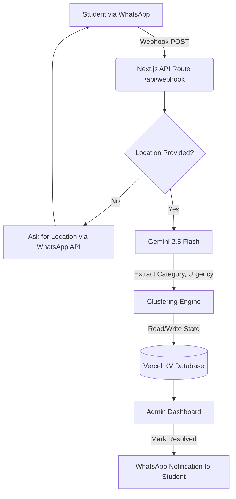

# DAU Pulse: Project Documentation

## 1. System Architecture Overview

DAU Pulse operates on a serverless architecture designed for high availability and low latency, utilizing Next.js App Router, Vercel Serverless Functions, and Upstash Redis.

## 2. Core Components

### 2.1 Webhook Receiver (`src/app/api/webhook/route.ts`)
- **Purpose**: Acts as the single entry point for all incoming WhatsApp messages from Meta's Cloud API.
- **Idempotency**: Implements a safety check using Meta's unique `message.id`. If a webhook times out and Meta retries, the backend instantly recognizes the duplicate ID in the database and returns a 200 OK without double-processing.
- **State Machine**: Tracks user sessions. If the NLP engine determines a user forgot to specify their location, the webhook saves a session state (`awaiting_location`) and pauses processing until the user replies.

### 2.2 NLP Engine (`src/lib/ai.ts`)
- **Purpose**: Replaces traditional drop-down menus with intelligent natural language processing.
- **Implementation**: Utilizes `GoogleGenAI` and the `gemini-2.5-flash` model. We pass a strict JSON Schema (`responseSchema`) to the model to guarantee structured output containing:
  - `category`: The responsible department.
  - `subCategory`: Specific issue type.
  - `location`: Physical campus location (or 'Location Pending').
  - `urgency`: An integer score from 1-5 based on safety and widespread disruption.

### 2.3 Clustering Engine (`src/lib/ai.ts`)
- **Purpose**: Prevents admin dashboard fatigue by grouping similar reports together.
- **Logic**: Compares incoming issues against active `Clusters`. A match is declared if:
  1. The category is identical.
  2. The specific location matches exactly.
  3. There is a significant keyword overlap in the description or summary (excluding stop words).
- If matched, the incoming issue is appended to the cluster, the `reportCount` increments, and the overall cluster urgency is dynamically boosted.

### 2.4 Data Persistence (`src/lib/store.ts`)
- **Purpose**: Stores application state in a fast, serverless-compatible way.
- **Implementation**: Uses `@vercel/kv` (Upstash Redis) to store a structured JSON object containing `issues`, `clusters`, `sessions`, and `processedMessageIds`. This replaces traditional file-system storage which is ephemeral in Vercel functions.

### 2.5 Admin Dashboard (`src/app/admin/page.tsx`)
- **Purpose**: Command center for university administration.
- **Implementation**: React Server Components fetch real-time data from Vercel KV. The UI is built with TailwindCSS and Lucide-React icons, featuring dynamic red/yellow urgency badges and one-click resolution buttons via Next.js Server Actions.

## 3. Deployment Configuration

The application is deployed on Vercel with the following required environment variables:
- `KV_REST_API_URL` & `KV_REST_API_TOKEN`: Database connection strings.
- `WHATSAPP_ACCESS_TOKEN`, `WHATSAPP_PHONE_NUMBER_ID`, `WHATSAPP_VERIFY_TOKEN`: Meta API authentication.
- `GEMINI_API_KEY`: Google AI authentication.

## 4. Known Limitations & Future Work
- **Rate Limiting**: The current Meta Dev Tier limits outgoing messages to verified test numbers. Future production releases will require Meta Business Verification to message any student.
- **Image Support**: Currently, the webhook only processes `type: 'text'`. Future updates will parse incoming images and pass them to Gemini Pro Vision for visual issue confirmation (e.g., analyzing a photo of a broken pipe).
