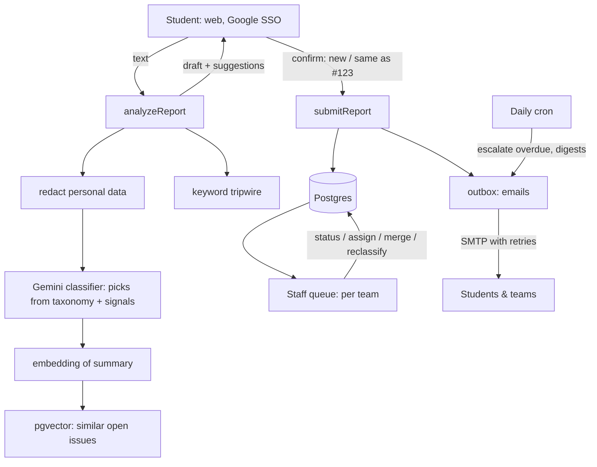

# DAU Pulse: Project Documentation (v2)

## 1. The problem

Campus problems get reported through class reps, emails and random WhatsApp groups. Nobody owns them, the same problem is reported many times, and students never find out whether anything happened. The hard part is not understanding the complaint; it is **accountability and closing the loop**: the right team sees it, someone owns it, there's a deadline, and the student is told what was done.

## 2. What changed from the buildathon prototype

| Prototype (v1) | v2 | Why |
|---|---|---|
| Whole database in one Redis key, read-modify-write on every message | Postgres (pgvector), transactions, row locks | Two simultaneous reports overwrote each other |
| No login; `/admin` and `clearDatabase` open to anyone | Google Workspace SSO, roles, per-team access enforced on every page and action | Student phone numbers and ragging reports were public |
| Webhook unauthenticated, LLM call before replying | Web-first intake; WhatsApp becomes a thin adapter later | Fake complaints, Meta retries, 24h window, template costs |
| Silent keyword-overlap clustering | Embedding similarity suggests matches; the student or staff member confirms | One shared word merged unrelated reports, while synonyms split real duplicates |
| LLM picks urgency 1–5 | LLM extracts signals; urgency is a formula | Consistent and explainable to staff |
| Ragging reports visible to every admin | Restricted to the grievance committee; keyword check alongside the AI | Confidentiality |
| No deadlines, no notifications except "resolved" | SLA by urgency, daily digests, escalation, email on every status change | Staff don't open dashboards daily; email brings the queue to them |
| No tests, no way to measure the AI | 50+ integration tests; `npm run eval` on 96 labelled messages | Prompt changes can be checked before deploy |

## 3. Architecture

### 3.1 The core (`src/core/`) is channel-agnostic
The web pages and server actions are thin: check who is signed in, call the core, revalidate. A WhatsApp adapter would call the same two functions:

- `analyzeReport(deps, actor, { text, channel })` validates and rate-limits, then redacts personal data, runs the tripwire, classifies, embeds and finds similar issues. It stores a **draft** server-side (30-minute expiry) and returns the suggestions.
- `submitReport(deps, actor, { draftId, choice, …confirmations })` claims the draft atomically (so a double submit can't create two issues), then joins an existing issue or creates a new one, and queues emails.
- `reportSameIssue(deps, actor, issueId)` is the "me too" button on the board.

`deps` holds the database, classifier, embedder, clock and config, so tests run the real logic against a real Postgres with a fake AI.

### 3.2 Classification: "the AI extracts, code decides"
Gemini receives the redacted text plus the taxonomy (teams, categories with what does and doesn't belong, places with aliases) and must answer in a JSON schema whose fields are **enums**. The output is validated again (`src/core/ai/prompt.ts`): an unknown slug becomes `null`, and a subcategory from another category is dropped.

It returns `category`, `subcategory`, `location`, `title`, a neutral one-sentence `summary`, the signals (`severity`, `safetyRisk`, `affectsMany`, `timeSensitive`, `isSensitive`) and `confidence`. Code then decides the rest:
- **Routing:** category → department, from the database.
- **Urgency** (`urgency.ts`): low 1 · medium 2 · high 3; +1 if it affects many people; +1 if it's time-sensitive; +1 at 3 reporters and +1 more at 10. Safety risks and sensitive issues are always 5.
- **Deadline** (`sla.ts`): 4h / 24h / 3d / 7d / 14d for urgency 5…1. Deadlines only move earlier.
- **Triage:** if confidence is below 0.55 and the student didn't correct the category, the issue is flagged for an admin to confirm.
- **Location follow-up:** categories that need a place ask for one if the AI didn't find it.

Model fallbacks: `GEMINI_MODELS` are tried in order, and transient errors are retried. If every model fails, the student picks the category themselves; nothing is lost. See [ModelSelection.md](ModelSelection.md) for why Gemini, and when to revisit that.

### 3.3 Duplicates: suggest, never merge silently
The issue summary is embedded (`gemini-embedding-001`, 768 dims) and compared by cosine similarity against open issues from the last 45 days. Different known places never match. Matches in the same category are shown above `possibleMatch`, and cross-category matches only above `strongMatch`. The student chooses "same problem" or "new". If they choose "new" despite a match, the issue is flagged as a possible duplicate, and staff can merge it in one click. Merging moves the reports, recounts reporters, recomputes urgency and tells the merged issue's reporters where to follow it. Thresholds are measured with `npm run eval`.

### 3.4 Sensitive reports
A report is sensitive if **any** of these is true: the AI says so, the keyword tripwire fires (`sensitive.ts`, tuned to catch everything, Hinglish included), or the student picks the Grievance category. Then:
- It goes to the Grievance & Anti-Ragging Committee regardless of its topic.
- Only members of that team can see it. Admins are deliberately excluded; the committee decides what to escalate.
- It is never on the board, never offered as a match, and never embedded.
- The committee gets an alert email **without** the report content.
- Crisis language shows the Tele-MANAS helpline (14416) to the student straight away.
- False alarms are cheap: the committee reclassifies them out.

### 3.5 Data model (`src/db/schema.ts`)
- `issues`: one real-world problem, with category, place, team, status, urgency, signals, reporter count, assignee, deadline, embedding, and links to possible duplicates and merges.
- `reports`: one per student per issue (unique), holding the original text, the AI's verdict at the time, and whether the student corrected it. **That is the labelled training data** (`npm run export:labels`).
- `issue_events`: audit log of every change. Public events are shown to reporters; internal notes and assignments are not.
- `drafts`: analysed-but-not-submitted reports.
- `outbox`: emails, delivered with retries.
- `departments`, `categories`, `subcategories`, `locations`: the taxonomy, seeded from `src/config/taxonomy.ts`.
- `users`: role, department, active flag. Loaded fresh on every request, so changes apply immediately.

### 3.6 Access rules (`permissions.ts`, mirrored in SQL in `queries.ts`)
- Students see the public board and the issues they reported themselves.
- Staff see their own team's queue.
- Admins see all non-sensitive issues and the triage queue.
- Sensitive issues are visible only to the team they're routed to.
- Anonymous reporters are shown as "Anonymous student" to everyone in the app.

### 3.7 Reliability
- **Exact counts:** row locks serialise concurrent "me too"s. There's a test where 20 parallel reports are all counted.
- **No double submits:** the draft is claimed with `UPDATE … WHERE consumed_at IS NULL`.
- **Emails:** an outbox row is written in the same transaction as the change, then delivered with retries.
- **Safe errors:** errors shown to users are safe messages; stack traces never reach the browser.
- **Rate limits:** each student gets 30 analyses and 10 reports per hour.
- **Monitoring:** `/api/health` reports database reachability.
- **AI outages heal themselves:** `backfill.ts` re-classifies reports filed while Gemini was down. It fills in the title, summary and embedding, flags near-duplicates, and routes the report to the committee if the AI now judges it sensitive. It runs after each submit and from the cron routes.

## 4. Adding WhatsApp later
Write `src/app/api/whatsapp/route.ts`. It should verify `X-Hub-Signature-256`, return 200 immediately, and process each message with `after()`:
1. Look up or create the user by phone. **Decision needed:** how to link a phone number to a college account, e.g. a one-time code sent to the student's college email.
2. Call `analyzeReport`. Turn the candidates into reply buttons ("Same as DP-1042?"), and the follow-up question into a list message of places.
3. Call `submitReport` with the draft id when they answer (drafts expire after 30 minutes, which fixes the prototype's "session never expires" bug).
4. Send status changes as approved WhatsApp templates (needed outside the 24h window).

## 5. Known limitations / next steps
- The taxonomy and building names are placeholders until the administration confirms them.
- No photo attachments yet.
- No analytics page yet (counts by team and month, time to resolve). The data is all in `issues` and `issue_events`.
- The eval set is synthetic. Replace or extend it with exported real reports after launch.
